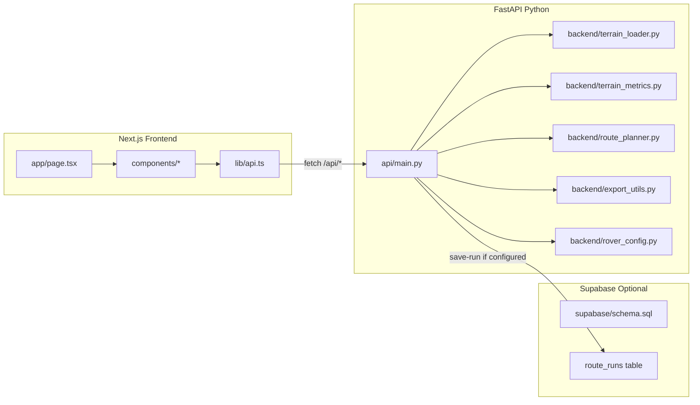
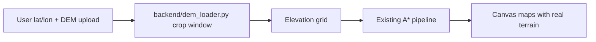

# ICAROS MVP — Build Plan

**ICAROS**: Intelligent Crater-Aware Route Optimization System

Use this document as a stage-by-stage reference while building the project. Check off each item as you complete it.

---

## Overview

Build a deployable MVP with:

- **Next.js** frontend (TypeScript)
- **FastAPI** Python route-planning engine
- **Supabase** for optional route-run persistence
- **Vercel** deployment

**Framing:** ICAROS is the route-planning and decision-support layer. Project Chrono is the physics simulation engine. ICAROS identifies candidate routes, scores them, and exports them for later Project Chrono testing — it does not replace Project Chrono.

**MVP limitation:** Synthetic lunar terrain only. No real NASA DEM uploads yet. No Project Chrono dependency.

**Learning goal:** Python backend must be beginner-readable — simple functions, docstrings, clear comments, minimal classes.

---


## Rover Data (User-Provided)

These specs replace the original placeholder rovers. Use these names and values everywhere in the app.

### Astrolab CLV-1


| Field               | Value                                                                                                                                                                                          |
| ------------------- | ---------------------------------------------------------------------------------------------------------------------------------------------------------------------------------------------- |
| max_slope_deg       | 20                                                                                                                                                                                             |
| nominal_speed_mps   | 2.8                                                                                                                                                                                            |
| roughness_tolerance | 0.3                                                                                                                                                                                            |
| energy_factor       | 1.18                                                                                                                                                                                           |
| description         | Crewed Lunar Vehicle 1, an adapted, 2,000-pound version of Astrolab's FLEX architecture built with Axiom Space. Prioritizes structural robustness and cargo volume with a top speed of 10 kph. |


### Lunar Outpost Pegasus


| Field               | Value                                                                                                                                                                                             |
| ------------------- | ------------------------------------------------------------------------------------------------------------------------------------------------------------------------------------------------- |
| max_slope_deg       | 20                                                                                                                                                                                                |
| nominal_speed_mps   | 4.0                                                                                                                                                                                               |
| roughness_tolerance | 0.3                                                                                                                                                                                               |
| energy_factor       | 1.10                                                                                                                                                                                              |
| description         | A lighter, highly agile evolution of the Eagle rover built with GM and Lockheed Martin. Optimized for human-centered mobility with speeds exceeding 9 mph over frozen, rugged South Pole terrain. |


**Files to update with this data when building:**

- `backend/rover_config.py` — rover dicts and profile names
- `supabase/schema.sql` — seed INSERT rows
- `api/main.py` — default `rover_name` in PlanRouteRequest
- Frontend defaults in `RouteControls.tsx` / `page.tsx`

**Note:** Both rovers share the same `max_slope_deg` (20°) and `roughness_tolerance` (0.3). Pegasus is faster (4.0 vs 2.8 m/s) with lower energy factor (1.10 vs 1.18), so route comparisons will differ mainly on travel time and energy score.

---


## Build Stages (Checklist)


| Stage | Name                                                         | Status |
| ----- | ------------------------------------------------------------ | ------ |
| 1     | [Project Scaffolding](#stage-1-project-scaffolding)          | ☑      |
| 2     | [Python Backend](#stage-2-python-backend-beginner-readable)  | ☑      |
| 3     | [FastAPI Layer](#stage-3-fastapi-layer)                      | ☑      |
| 4     | [Supabase Schema](#stage-4-supabase-schema)                  | ☑      |
| 5     | [Next.js Frontend](#stage-5-nextjs-frontend)                 | ☑      |
| 6     | [README & Deployment Docs](#stage-6-readme--deployment-docs) | ☑      |
| 7     | [Quality Verification](#stage-7-quality-verification)        | ☑      |
| 8     | [Real Lunar DEM Terrain](#stage-8-real-lunar-dem-terrain)    | ☑      |
| 9     | [Route Comparison Dashboard](#stage-9-route-comparison-dashboard) | ☑      |


---


## Target Directory Structure

```
icaros/
├── PLAN.md                  ← this file
├── README.md
├── .env.example
├── .gitignore
├── package.json
├── tsconfig.json
├── next.config.js
├── vercel.json
├── requirements.txt
├── app/
│   ├── page.tsx
│   ├── layout.tsx
│   └── globals.css
├── components/
│   ├── TerrainMap.tsx
│   ├── RoverSelector.tsx
│   ├── RouteControls.tsx
│   ├── MetricsTable.tsx
│   └── RouteExport.tsx
├── lib/
│   ├── supabaseClient.ts
│   └── api.ts
├── api/
│   └── main.py
├── backend/
│   ├── __init__.py
│   ├── terrain_loader.py
│   ├── terrain_metrics.py
│   ├── route_planner.py
│   ├── rover_config.py
│   └── export_utils.py
└── supabase/
    └── schema.sql
```

---


## Architecture




**Data flow for route planning:**

1. User sets start, goal, rover, terrain params in the frontend
2. Frontend POSTs to `/api/plan-route`
3. Backend generates synthetic terrain → computes slope/roughness/hazard → runs A* → calculates metrics → returns grids + route + CSV
4. Frontend renders elevation map, hazard map, route overlay, and metrics table
5. User can export CSV or save run to Supabase (if configured)

---


## Stage 1: Project Scaffolding

**Goal:** Config files and folder structure in place. Nothing runs yet — that's OK.

### Files to create

- [x] `package.json` — Next.js scripts and dependencies
- [x] `tsconfig.json` — TypeScript config
- [x] `next.config.js` — dev proxy rewrites to FastAPI on `:8000`
- [x] `vercel.json` — Python runtime + route rewrites for FastAPI
- [x] `.gitignore` — ignore `.venv`, `node_modules`, `.env`
- [x] `.env.example` — Supabase env var placeholders
- [x] `requirements.txt` — Python dependencies


### Dependencies

**Frontend (**`package.json`**):**

- next, react, react-dom, typescript, @supabase/supabase-js

**Python (**`requirements.txt`**):**

- fastapi, uvicorn, numpy, pandas, scipy, supabase


### Local dev proxy (`next.config.js`)

```js
async rewrites() {
  return [
    { source: '/api/rovers', destination: 'http://127.0.0.1:8000/api/rovers' },
    { source: '/api/plan-route', destination: 'http://127.0.0.1:8000/api/plan-route' },
    { source: '/api/save-run', destination: 'http://127.0.0.1:8000/api/save-run' },
  ];
}
```

Frontend `lib/api.ts` uses **relative URLs** (`/api/plan-route`) so the same code works locally (via rewrite) and on Vercel (via `vercel.json` rewrites).

### Environment variables (`.env.example`)

```
NEXT_PUBLIC_SUPABASE_URL=
NEXT_PUBLIC_SUPABASE_ANON_KEY=
SUPABASE_URL=
SUPABASE_SERVICE_ROLE_KEY=
```

**Important:** Never expose `SUPABASE_SERVICE_ROLE_KEY` to the browser. Use `NEXT_PUBLIC_`* only for frontend-safe values.

### Done when

- [x] All config files exist
- [x] Empty directories created for `app/`, `components/`, `lib/`, `api/`, `backend/`, `supabase/`

---


## Stage 2: Python Backend (Beginner-Readable)

**Goal:** All route-planning logic in plain, explainable Python functions.

**Rules for this stage:**

- Simple functions, not classes
- Descriptive variable names
- Docstrings on every function
- Comments for non-obvious logic
- No clever one-liners


### `backend/__init__.py`

- [ ] Empty package marker


### `backend/rover_config.py`

- [ ] Two rover dicts with **user-provided** specs (see [Rover Data](#rover-data-user-provided) above):


| Rover                 | max_slope_deg | nominal_speed_mps | roughness_tolerance | energy_factor |
| --------------------- | ------------- | ----------------- | ------------------- | ------------- |
| Astrolab CLV-1        | 20            | 2.8               | 0.3                 | 1.18          |
| Lunar Outpost Pegasus | 20            | 4.0               | 0.3                 | 1.10          |


- [ ] `get_rover_by_name(name)` helper
- [ ] `get_all_rovers()` for the API


### `backend/terrain_loader.py`

- [ ] `load_synthetic_terrain(size=200, resolution_m_per_pixel=20)`
- [ ] Returns `elevation` (numpy 2D array) + `metadata` dict
- [ ] Generation steps (keep each step in its own commented block):
  1. Base rolling hills via `scipy.ndimage.gaussian_filter` on random noise
  2. Add small random noise layer
  3. Subtract 3–5 crater depressions using radial distance falloff from random centers


### `backend/terrain_metrics.py`

- [ ] `compute_slope(elevation, resolution_m_per_pixel)` — central differences, `arctan` to degrees
- [ ] `compute_roughness(elevation, window_size=5)` — local elevation std dev
- [ ] `normalize_grid(grid)` — min-max to 0–1
- [ ] `compute_hazard_score(slope, roughness, rover_config)` → returns `(hazard_score, blocked_mask)`:
  - Weighted sum of normalized slope + roughness (adjusted by `roughness_tolerance`)
  - Extra penalty when slope > 80% of `max_slope_deg`
  - `blocked_mask = slope > max_slope_deg`


### `backend/route_planner.py`

- [ ] `find_route(start, goal, hazard_score, blocked_mask, hazard_weight=5.0)`
  - 8-direction movement
  - Avoid blocked terrain
  - Euclidean heuristic
  - Movement cost = step distance + `hazard_weight * avg_hazard_of_cells`
  - Priority queue via `heapq`
  - Returns `(route, route_found, total_cost)`
- [ ] `is_valid_cell(row, col, grid_shape, blocked_mask)`
- [ ] `heuristic(a, b)` — Euclidean distance
- [ ] `reconstruct_path(came_from, current)`


### `backend/export_utils.py`

- [ ] `route_to_dataframe(route, elevation, slope, hazard_score, resolution_m_per_pixel)`
  - Columns: step, row, col, x_m, y_m, elevation_m, slope_deg, hazard_score
- [ ] `calculate_route_metrics(route_df, rover_config, resolution_m_per_pixel)`
  - distance_m, estimated_time_min, max_slope_deg, average_slope_deg, average_hazard_score, energy_score
- [ ] `dataframe_to_csv_string(route_df)`


### Done when

- [ ] Each module imports without errors
- [ ] You can explain every function in plain English

---


## Stage 3: FastAPI Layer

**Goal:** HTTP API that wires the Python modules together.

### `api/main.py`

- [ ] `app = FastAPI(title="ICAROS")` — must be named `app` for Vercel
- [ ] CORS enabled for local dev
- [ ] `sys.path` adjustment so `backend/` imports work on Vercel


### Endpoints


| Method | Path              | Behavior                       | Done |
| ------ | ----------------- | ------------------------------ | ---- |
| GET    | `/`               | Health check JSON              | ☐    |
| GET    | `/api/rovers`     | List rover configs             | ☐    |
| POST   | `/api/plan-route` | Full pipeline (see below)      | ☐    |
| POST   | `/api/save-run`   | Save to Supabase if configured | ☐    |


### POST `/api/plan-route`

**Request:**

```json
{
  "terrain_size": 200,
  "resolution_m_per_pixel": 20,
  "rover_name": "Astrolab CLV-1",
  "start": [20, 20],
  "goal": [170, 170],
  "hazard_weight": 5.0
}
```

**Response:**

```json
{
  "route_found": true,
  "terrain": [[...]],
  "slope": [[...]],
  "hazard_score": [[...]],
  "route": [[row, col], ...],
  "metrics": {
    "distance_m": 0,
    "estimated_time_min": 0,
    "max_slope_deg": 0,
    "average_slope_deg": 0,
    "average_hazard_score": 0,
    "energy_score": 0
  },
  "csv_data": "step,row,col,x_m,y_m,elevation_m,slope_deg,hazard_score\n..."
}
```

**Pipeline inside the endpoint:**

1. Load synthetic terrain
2. Compute slope, roughness, hazard score
3. Run A* pathfinding
4. Build route dataframe and metrics
5. Convert numpy arrays to lists for JSON
6. Return everything


### POST `/api/save-run`

- [ ] `is_supabase_configured()` checks `SUPABASE_URL` + `SUPABASE_SERVICE_ROLE_KEY`
- [ ] If not configured: return `{ "saved": false, "message": "Supabase not configured yet." }` with HTTP 200 (no crash)
- [ ] If configured: insert into `route_runs` table


### Done when

- [ ] `uvicorn api.main:app --reload` starts without errors
- [ ] `GET /` returns health check
- [ ] `GET /api/rovers` returns both rovers
- [ ] `POST /api/plan-route` returns a valid route

---


## Stage 4: Supabase Schema

**Goal:** Database schema ready. App works without it configured.

### `supabase/schema.sql`

- [ ] `rovers` table: id, name, max_slope_deg, nominal_speed_mps, roughness_tolerance, energy_factor, description, created_at
- [ ] Seed INSERT for Astrolab CLV-1 and Lunar Outpost Pegasus (see [Rover Data](#rover-data-user-provided))
- [ ] `route_runs` table: id, rover_name, terrain_size, resolution_m_per_pixel, start_row, start_col, goal_row, goal_col, hazard_weight, route_found, distance_m, estimated_time_min, max_slope_deg, average_slope_deg, average_hazard_score, energy_score, route_json (jsonb), created_at


### Frontend helper (`lib/supabaseClient.ts`)

- [ ] Client using `NEXT_PUBLIC_SUPABASE_URL` + `NEXT_PUBLIC_SUPABASE_ANON_KEY`
- [ ] `isSupabaseConfigured()` for UI messaging
- [ ] Save runs go through **FastAPI** (service role key stays server-side)


### Done when

- [ ] Schema runs in Supabase SQL editor without errors
- [ ] App shows "Supabase not configured yet." when env vars are missing
- [ ] App saves runs when env vars are present

---


## Stage 5: Next.js Frontend

**Goal:** Research-prototype UI that drives the full workflow.

**Style:** Simple, clean, not overdesigned. Light gray background, monospace accents, basic form controls.

### App shell

- [ ] `app/layout.tsx` — root layout
- [ ] `app/globals.css` — research-prototype styling
- [ ] `app/page.tsx` — main page with title, intro, controls, maps, metrics, export

**Page content:**

1. Title: "ICAROS: Intelligent Crater-Aware Route Optimization System"
2. Intro paragraph about lunar route planning and Project Chrono export
3. Controls panel
4. Three maps side-by-side (elevation, hazard, route)
5. Metrics table
6. CSV export + Save run buttons
7. Supabase status banner when not configured


### Components


| File                | Responsibility                                                                                              | Done |
| ------------------- | ----------------------------------------------------------------------------------------------------------- | ---- |
| `RouteControls.tsx` | Rover dropdown, terrain size slider, resolution input, start/goal row/col, hazard weight slider, Run button | ☐    |
| `RoverSelector.tsx` | Dropdown populated from `/api/rovers`                                                                       | ☐    |
| `TerrainMap.tsx`    | Canvas heatmap: grid → colors, route overlay, start/goal markers                                            | ☐    |
| `MetricsTable.tsx`  | Display route metrics                                                                                       | ☐    |
| `RouteExport.tsx`   | CSV download (Blob) + Save Run button                                                                       | ☐    |


### `TerrainMap.tsx` details

- Canvas-based heatmap renderer
- Color scale: blue → green → yellow → red
- Route drawn as white/cyan polyline
- Start = green circle, goal = red circle
- Fixed display size (e.g. 400×400px), scales cell rendering to fit


### `lib/api.ts`

- [ ] `fetchRovers()` — GET `/api/rovers`
- [ ] `planRoute(params)` — POST `/api/plan-route`
- [ ] `saveRun(data)` — POST `/api/save-run`
- [ ] Typed interfaces for request/response
- [ ] User-friendly error messages


### Done when

- [ ] `npm run dev` starts without errors
- [ ] Controls submit to backend and display results
- [ ] Three maps render correctly
- [ ] CSV download works
- [ ] Save run shows appropriate message

---


## Stage 6: README & Deployment Docs

**Goal:** `README.md` explains the project and how to run/deploy it.

### Sections to include

1. [ ] What ICAROS is
2. [ ] Why ICAROS is not redundant with Project Chrono
3. [ ] Architecture (Next.js → FastAPI → Supabase → future Project Chrono)
4. [ ] Local run instructions
5. [ ] Supabase setup
6. [ ] Vercel deployment
7. [ ] How the Python route planner works (plain-language A* walkthrough)
8. [ ] Files to study first:
  - `backend/terrain_loader.py`
  - `backend/terrain_metrics.py`
  - `backend/route_planner.py`
  - `backend/export_utils.py`
  - `api/main.py`
9. [ ] Future improvements:
  - Illumination/shadow constraints
  - Thermal constraints
  - Battery/solar model
  - Project Chrono route export
  - 3D visualization
  - Validation with rover-terrain simulation

(Real NASA DEM import → **Stage 8**. Route comparison dashboard → **Stage 9**.)


### Local run commands

```bash
# Python backend
python3 -m venv .venv
source .venv/bin/activate
pip install -r requirements.txt
uvicorn api.main:app --reload

# Frontend (separate terminal)
npm install
npm run dev
```


### Vercel deployment notes

- Connect repo to Vercel
- Set env vars in Vercel dashboard
- `requirements.txt` at root for Python functions
- FastAPI instance must be named `app` in `api/main.py`
- Both frontend and API deploy together via `vercel.json`


### Done when

- [ ] README covers all 9 sections
- [ ] Someone unfamiliar with the project can run it locally from README alone

---


## Stage 7: Quality Verification

**Goal:** Everything works end-to-end before calling the MVP done.

### Checks


| #   | Check             | Command / Method                                            | Done |
| --- | ----------------- | ----------------------------------------------------------- | ---- |
| 1   | Python imports    | `python -c "from api.main import app"`                      | ☐    |
| 2   | API smoke test    | POST `/api/plan-route` with default params                  | ☐    |
| 3   | A* sanity         | Route found for easy start/goal                             | ☐    |
| 4   | A* detour         | Blocked terrain forces alternate path                       | ☐    |
| 5   | CSV export        | Header row + correct step count                             | ☐    |
| 6   | Frontend build    | `npm run build`                                             | ☐    |
| 7   | Supabase fallback | save-run without env vars returns helpful message           | ☐    |
| 8   | Readability       | Each Python file has module docstring + function docstrings | ☐    |
| 9   | Broken paths      | No 404s or import errors anywhere                           | ☐    |
| 10  | Synthetic terrain | Craters visible in elevation map                            | ☐    |


### Done when

- [ ] All 10 checks pass
- [ ] MVP is deployable to Vercel

---

## Stage 8: Real Lunar DEM Terrain

**Goal:** Load real NASA lunar elevation data for a specific lat/lon on the Moon. User picks a site in coordinates, uploads (or loads) a DEM, and sets start/goal in local meters on that real terrain.

**You do NOT need upload for the synthetic MVP (Stages 1–7). This stage adds real terrain on top.**

### User workflow

1. Enter **center latitude / longitude** (e.g. `-89.5`, `0.0` near lunar South Pole)
2. Upload a **GeoTIFF DEM** downloaded from NASA/USGS (or select from Supabase Storage if saved)
3. Backend **crops a window** around that coordinate (size in meters from existing terrain size + resolution controls)
4. Enter **start and goal in local meters** (x_m, y_m relative to center) — converted to grid row/col internally
5. Run optimization — same maps and metrics, but on **real elevation**
6. CSV export includes lat/lon or local meters for Project Chrono handoff



### NASA data sources (download first)

- **LOLA DEM** — global lunar elevation (USGS Astrogeology)
- **LROC NAC DTMs** — higher resolution for specific sites (South Pole regions)
- Format: **GeoTIFF** (`.tif`) with embedded georeferencing

Document in README where to download and recommended South Pole products.

### New backend files

| File | Purpose |
|------|---------|
| `backend/dem_loader.py` | Load GeoTIFF with rasterio; crop by lat/lon + window size; return elevation + metadata |
| `backend/coordinates.py` | Convert lat/lon ↔ local x_m/y_m ↔ grid row/col (lunar polar stereographic) |

`load_dem_terrain(file_path, center_lat, center_lon, window_m, resolution_m_per_pixel)` returns same shape as synthetic loader so `terrain_metrics`, `route_planner`, and `export_utils` stay unchanged.

### API changes

| Method | Path | Behavior |
|--------|------|----------|
| POST | `/api/upload-dem` | Multipart file upload; validate GeoTIFF; store temp or Supabase Storage; return `terrain_id` + bounds |
| POST | `/api/plan-route` | Add optional fields: `terrain_mode` (`synthetic` \| `dem`), `terrain_id`, `center_lat`, `center_lon`, `start_m`, `goal_m` |

When `terrain_mode=dem`, skip synthetic generation and use cropped real elevation.

### Frontend changes

- Terrain mode toggle: **Synthetic** | **Real DEM (NASA)**
- Lat/lon inputs for site center
- File upload for `.tif`
- Start/goal in **meters** (x_m, y_m) when using real DEM
- Map title shows real coordinates and data source name

### Dependencies

Add to `requirements.txt`:
- `rasterio` — read GeoTIFF elevation
- `pyproj` — lunar coordinate transforms (IAU Moon 2000 / polar stereographic)

### Storage note

Lunar DEM files can be **large** (100MB+). Vercel serverless has upload/time limits. Options:
- **Local dev:** upload to backend `data/` folder (simplest for simulation work)
- **Production:** Supabase Storage for DEM files; backend crops on demand

For Mia's simulation, **local dev + file upload** is the recommended first step.

### Done when

- [x] User can upload a NASA GeoTIFF and see real elevation on the map
- [x] Center lat/lon selects the correct region of the Moon
- [x] Start/goal in local meters produce a valid route on real terrain
- [x] CSV includes coordinates usable for Project Chrono
- [x] Synthetic mode still works unchanged

---

## Stage 9: Route Comparison Dashboard

**Goal:** Same-session comparison of Astrolab CLV-1 vs Lunar Outpost Pegasus on **identical terrain** (synthetic or real DEM).

- `POST /api/compare-routes` — generate/load terrain once, plan both rovers
- `RouteComparisonDashboard.tsx` — side-by-side energy, distance, time, slopes
- Works with whichever terrain mode is active (Stage 8)

### Done when

- [x] Compare button shows both rovers on same terrain
- [x] Best metric per column highlighted
- [x] Handles "no route found" for one rover
- [x] Safest alternative column (hazard weight 15) with 0–100 scores

---


## Key Design Decisions


| Decision                                      | Rationale                               |
| --------------------------------------------- | --------------------------------------- |
| No classes in Python (except Pydantic models) | Beginner readability                    |
| No rasterio                                   | Synthetic terrain only for MVP          |
| No Project Chrono                             | Planning layer, not simulation          |
| Full grids in API response                    | Frontend heatmaps without tile endpoint |
| Service role key server-side only             | Security                                |
| Relative API URLs                             | Same fetch pattern for local + Vercel   |
| Supabase optional                             | App works without database configured   |


---


## Estimated File Count

~25 files total:

- 6 Python backend modules
- 1 FastAPI entry
- 5 React components
- 2 lib files
- 3 app files
- 4 config files
- schema, README, PLAN, env example, gitignore

---


## Quick Reference: MVP Feature List

1. Generate synthetic lunar-like terrain
2. Display terrain as a map (elevation + hazard heatmaps)
3. User chooses start point and end point
4. User selects rover profile (Astrolab CLV-1 or Lunar Outpost Pegasus)
5. Compute terrain metrics (elevation, slope, roughness, hazard score)
6. A* pathfinding for optimized route
7. Compare route metrics (distance, slopes, hazard, time, energy)
8. Display route on terrain map
9. Export route as CSV
10. Save route runs to Supabase (optional)
11. Deploy to Vercel

